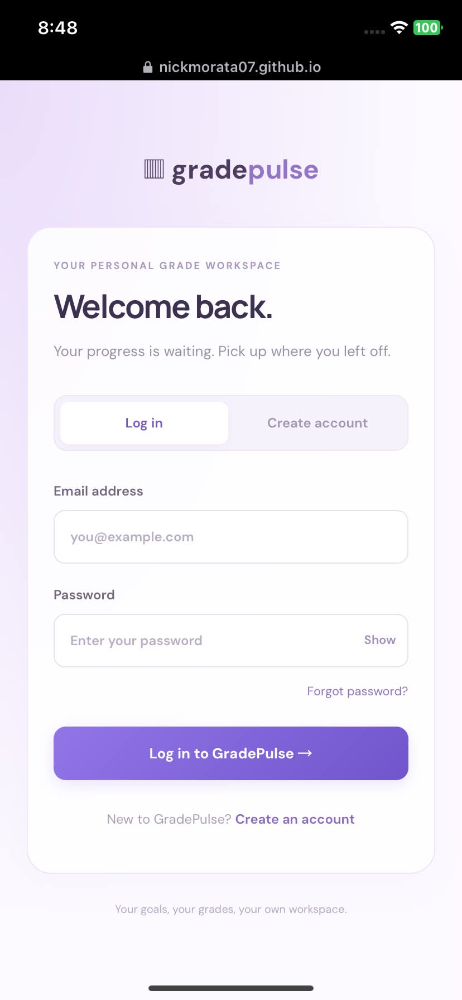

# GradePulse

GradePulse is a student grade tracker and final-grade forecaster. Students record courses, weighted assessment categories, and scores to monitor their progress and estimate the results needed to reach a target grade.

- **Live app:** https://nickmorata07.github.io/gradepulse-fullstack/
- **Public repository:** https://github.com/nickmorata07/gradepulse-fullstack
- **Backend readiness:** https://gradepulse-api.onrender.com/readyz
- **Security review:** [SECURITY-CHECKLIST.md](SECURITY-CHECKLIST.md)

## Features and usage

1. Create an account, open the confirmation email, then log in. Each account has its own workspace. Password recovery and logout are available.
2. Add a course with a course code, name, and target grade.
3. Add assessment categories and their percentage weights. Weights cannot exceed 100%; use a total of 100% for final-grade forecasts.
4. Record earned and possible points. Category averages use total earned points divided by total possible points.
5. Open Grade forecaster, choose the course, and mark categories complete only when all their scores are final. Review the required remaining average, current-pace estimate, best possible outcome, and adjustable what-if scenario.
6. Export the forecast as CSV. Deleting or adding an assessment reopens its category so the forecast can be reviewed again.

The dashboard supports desktop and phone layouts, with mobile navigation. Saved courses and assessments use the authenticated Express API and PostgreSQL; they are not browser-only demo data.

## Technology and architecture

React 18 and Vite provide the frontend. Node.js 22 or newer runs the Express API, which uses the `pg` PostgreSQL driver. Supabase provides PostgreSQL and email/password authentication. GitHub Pages hosts the frontend; Render hosts the backend. The browser sends a Supabase bearer token on API requests; the backend verifies it with Supabase and applies account ownership checks to database queries.

## Setup and installation

Install Node.js 22 or newer (with npm) and Git. Create a Supabase project with PostgreSQL and email/password authentication enabled. A separate local PostgreSQL installation is not required when using Supabase.

```bash
git clone https://github.com/nickmorata07/gradepulse-fullstack.git
cd gradepulse-fullstack
```

Copy `server/.env.example` to `server/.env` and `client/.env.example` to `client/.env`, then replace the placeholders. Both `.env` files must remain uncommitted.

### Server environment

| Variable | Example / purpose |
| --- | --- |
| `DATABASE_URL` | `postgresql://DB_USER:DB_PASSWORD@DB_HOST:5432/postgres` — actual Supabase connection string, server only |
| `SUPABASE_URL` | `https://YOUR_PROJECT_REF.supabase.co` |
| `SUPABASE_PUBLISHABLE_KEY` | `YOUR_PUBLIC_PUBLISHABLE_KEY` — public key for Auth verification |
| `SUPABASE_ANON_KEY` | Optional legacy public-key alternative if publishable key is unset |
| `CORS_ORIGINS` | Local: `http://localhost:5173,http://localhost:5174`; hosted: `https://nickmorata07.github.io` |
| `PORT` | `5000` locally; use the hosting provider's assigned port in production |
| `NODE_ENV` | `development` locally; `production` on the backend host |

Use the connection string supplied by Supabase, including its correct username, host, and port. URL-encode special characters in the database password when necessary. Never place `DATABASE_URL` in a frontend variable.

### Client environment

| Variable | Example / purpose |
| --- | --- |
| `VITE_SUPABASE_URL` | `https://YOUR_PROJECT_REF.supabase.co` |
| `VITE_SUPABASE_PUBLISHABLE_KEY` | `YOUR_PUBLIC_PUBLISHABLE_KEY` |
| `VITE_SUPABASE_ANON_KEY` | Optional legacy public-key alternative |
| `VITE_API_BASE_URL` | Empty locally for the Vite proxy; hosted: `https://gradepulse-api.onrender.com` |
| `VITE_BASE_PATH` | `/` locally; `/gradepulse-fullstack/` for GitHub Pages |

All `VITE_` settings are public and compiled into browser JavaScript. Never use a Supabase secret/service-role key here. The current API module uses the real API; the older `VITE_USE_MOCK_API` setting is no longer used.

### Database setup

For a fresh Supabase project, run these files in order in its SQL Editor:

1. `server/db/schema.sql` — courses, category weights, and assessment scores.
2. `server/db/auth-mobile.sql` — account ownership, category completion, and Row Level Security policies.

For an existing GradePulse database that already has the base tables, run `auth-mobile.sql` only. This migration is designed to preserve existing records. Old courses with no owner remain hidden until explicitly assigned.

No seed data is required: sign up and add a sample course in the app. `server/db/seed.sql` is an optional development-only seed that **truncates the grade tables**; do not run it or `npm run db:reset` against an existing database. Its sample courses have no account owner. To claim legacy/sample courses, review `assign-existing.example.sql`, replace its email placeholder, and run it only if all unassigned courses belong to that account.

In Supabase Authentication URL Configuration, allow the actual development URL (for example `http://localhost:5173/`) and the deployed frontend URL. Set the production Site URL to `https://nickmorata07.github.io/gradepulse-fullstack/`. Request fresh emails after changing redirect settings.

## Run locally

Open two terminals, both starting from the repository root.

**Backend:**

```bash
cd server
npm ci
npm run dev
```

**Frontend:**

```bash
cd client
npm ci
npm run dev
```

Open the exact Local URL printed by Vite, normally `http://localhost:5173/`. If occupied, Vite uses another port; allow that URL in Supabase as well. The first screen is login/create account. The development proxy sends `/api` requests to port 5000.

Check `http://localhost:5000/healthz` for API availability and `/readyz` for database/schema availability. Readiness success returns `{"ok":true,"database":"connected"}`. The backend root `/` has no homepage and returns a route-not-found response.

For a phone on the same Wi-Fi, use Vite's Network URL with both terminals running. `localhost` on the phone refers to the phone. Public hosting removes the same-Wi-Fi requirement.

## API reference

All `/api` endpoints require `Authorization: Bearer <Supabase access token>`; access is restricted to the authenticated account's records. Login, signup, and password recovery use the Supabase Auth SDK rather than custom Express password routes.

| Method | Path | Purpose |
| --- | --- | --- |
| GET | `/healthz` | Public process health check |
| GET | `/readyz` | Public database and required-column readiness check |
| GET | `/api/courses` | List owned courses with categories and assessments |
| POST | `/api/courses` | Create a course: `course_code`, `course_name`, `target_grade` |
| GET | `/api/courses/:id` | Get one owned course |
| PATCH | `/api/courses/:id` | Update `target_grade` |
| DELETE | `/api/courses/:id` | Delete a course and dependent grade records |
| POST | `/api/courses/:id/categories` | Add `category_name` and `weight_percentage` |
| PATCH | `/api/categories/:id` | Set boolean `is_complete`; an empty category cannot be completed |
| POST | `/api/categories/:id/assessments` | Add `item_name`, `score`, and `max_score` |
| DELETE | `/api/assessments/:id` | Delete a score and reopen its category |

Example JSON for creating a course:

```json
{"course_code":"DEMO-101","course_name":"Sample Course","target_grade":90}
```

Successful creation returns 201; successful deletion returns 204. Invalid input returns 400, missing/invalid login returns 401, disallowed browser origins return 403, missing or inaccessible records generally return 404, and unexpected failures return generic server errors. The category completion route returns 400 for an unavailable or empty category. User input is passed through SQL parameters.

## Deployment

The Render Node web service uses root directory `server`, build command `npm ci --omit=dev`, and start command `npm start`. Set its server environment in Render; do not upload `.env`. Set `CORS_ORIGINS` to the frontend origin without the repository path.

GitHub Pages uses `.github/workflows/deploy-pages.yml`. Select GitHub Actions as the Pages publishing source and configure repository **Actions variables** `VITE_API_BASE_URL`, `VITE_SUPABASE_URL`, and `VITE_SUPABASE_PUBLISHABLE_KEY`. The workflow sets the repository base path and uploads only `client/dist`. Run the workflow after changing these variables to rebuild the browser bundle.

## Project structure

| Location | Responsibility |
| --- | --- |
| `client/src/App.jsx` | Dashboard, course screens, and navigation |
| `client/src/components/AuthGate.jsx` | Login, signup, sessions, and recovery |
| `client/src/components/ForecastWorkspace.jsx` | Forecast UI and score management |
| `client/src/forecast.js` | Forecast calculations and CSV formatting |
| `client/src/api/` | Authenticated HTTP client |
| `client/src/supabase.js` | Browser Supabase configuration |
| `server/server.js` | Production token verification and API startup |
| `server/app.js` | Routes, ownership checks, validation, and error handling |
| `server/db/` | Connection pool, schema, migration, and optional seed |
| `server/test/` | API isolation and SQL policy test |
| `.github/workflows/` | Pages deployment |
| `docs/` | Project documentation and screenshots |

## Screenshots

Actual published login screen opened on a phone:



## Verification

From `server`, run `npm test` to exercise API account isolation, ownership checks, validation, legacy-data preservation, and SQL policies against a PGlite test database. Its token verifier is stubbed; it does not test live Supabase email delivery. From `client`, run `node --test src/forecast.test.js` for forecast/CSV checks and `npm run build` for the production build.

Before submitting, test the hosted app: register and confirm an account, log in, add a course/category/score, refresh to check persistence, review a forecast, and log out. Check a second account cannot see the first account's courses. Test on mobile data and check `/readyz`. A deployed login screen alone does not prove these flows passed.

## Known issues and next steps

- Render's free backend can sleep when idle, delaying the first request. Retry after it wakes.
- Forecasts depend on entered grades, correct weights, and accurate completion flags; they are estimates, not official grades or machine-learning predictions.
- Legacy seed/mock files remain in the repository but are not the active production API. Their older documentation may need cleanup.
- The current database pool uses TLS without certificate verification for hosted connections. Configure trusted certificate verification and a least-privilege database role as further hardening.
- Rate limiting and broader live end-to-end tests are future improvements. Action versions currently use tags rather than immutable SHAs.
- Review the security checklist's No answers and finish the provider-setting checks before declaring the review complete.

## Credits

Development assistance: OpenAI ChatGPT / Codex. AI use and authorship are recorded in [AI-USAGE.md](AI-USAGE.md); the separate badge documentation is maintained there. Fonts: DM Sans and Manrope, loaded through Google Fonts. Repository license files are retained.
